# Airunote exam admin — complete UX review and proposed screens

**Prepared:** 12 October 2026 · **Status:** Original design proposal

**Local implementation followed:** See the [implementation and local test guide](LOCAL-TEST-GUIDE.md). The sandbox is available at [localhost:3000/dev/admin](http://localhost:3000/dev/admin); no deployment has been performed.

**Recommendation:** Keep all the existing power. Give that power a clearer structure, explicit save states, and fast access from the task an admin is doing.

This report contains 24 proposed views, 24 desktop drawings, 24 mobile drawings, and four dark admin-shell examples. These are deterministic HTML/CSS mockups with illustrative data, not screenshots of an implemented redesign. Their controls are visual specifications, not connected application actions. Existing artwork is used to represent the current holiday renderer; these compositions do not replace its approved layout or animation.

## Read this first

The admin already has substantial capability. Its main problem is information hierarchy: settings, sharing, testing, publishing, and saving are crowded together. Long forms make related decisions hard to compare. Advanced controls exist but are not consistently explained in terms of their consequences.

The proposed architecture has two levels:

- **Organization:** Exams, Templates, Files, Notes & folders, and Workspace settings.
- **An exam:** Setup, Questions, Appearance, Preview, Share, JSON pro, and Reports.

Setup and Appearance use lightweight subsection navigation. These are connected views of the same draft, not separate wizards. An experienced admin can jump directly to any subsection, JSON, or report. A new admin sees a manageable task at a time. No forced step-by-step progression is proposed.

**Preserve manual saving.** The current implementation has separate exam-definition and appearance persistence. Show **Exam: Saved / Unsaved** and **Appearance: Saved / Unsaved** independently. In each editing context, the primary button names what it saves. Do not imply autosave, atomic “save everything,” or unpublished revision staging when those behaviors do not exist.

**Preserve all respondent instructions and identity fields.** The handover records the user's rejection of collapsed respondent content. Grouping admin controls does not authorize hiding respondent instructions or optional identity fields.

**Preserve the full exam title and source content.** Any shorter campaign breadcrumb in these drawings is navigational shorthand. The actual title, instructions, questions, options, and answer keys must remain untouched unless edited deliberately by the admin.

### Scope and evidence

This review covers the exam administration system represented by the supplied screenshots and the local source: exam dashboard, editor, settings, questions and sections, JSON, appearance, preview, sharing/code dialogs, reporting, appearance templates, native file library, and exam workspace journey settings. It does not claim an audit of unrelated organization membership, billing, authentication, notes editors, or every Airunote product surface.

Reviewed source files include:

- [HANDOVER](../../HANDOVER.md) and [repository instructions](../../AGENTS.md)
- [ExamDashboard](../../frontend/components/exams/ExamDashboard.tsx), [ExamBuilder](../../frontend/components/exams/ExamBuilder.tsx), [ExamSettingsEditor](../../frontend/components/exams/ExamSettingsEditor.tsx)
- [ExamQuestionsEditor](../../frontend/components/exams/ExamQuestionsEditor.tsx), [ExamJsonEditor](../../frontend/components/exams/ExamJsonEditor.tsx), [section-management contract](../exam-section-management.md)
- [ExamAppearanceEditor](../../frontend/components/exams/ExamAppearanceEditor.tsx), [AppearanceFields](../../frontend/components/exams/AppearanceFields.tsx), [AppearancePreview](../../frontend/components/exams/AppearancePreview.tsx), [PreviewGallery](../../frontend/components/exams/PreviewGallery.tsx)
- [PreviewCodeControl](../../frontend/components/exams/PreviewCodeControl.tsx), [ExamReports](../../frontend/components/exams/ExamReports.tsx), [examiner-code contract](../exam-examiner-code.md)
- [ExamTemplates](../../frontend/components/exams/ExamTemplates.tsx), [NativeFileLibrary](../../frontend/components/files/NativeFileLibrary.tsx), [ExamJourneySettings](../../frontend/components/exams/ExamJourneySettings.tsx)

The six supplied images are evidence of current visual presentation. Local source reveals additional capabilities and may be ahead of the deployed version in those images. Findings about implemented behavior are source-based; no authenticated production actions or data mutations were performed. Mock participant names and metrics are illustrative.

## 1. Ratings, reasons, and the path to 10

UI means visual clarity and consistency. UX means task efficiency, navigation, and error prevention. UEX here means the resulting user experience: confidence, predictability, and recovery. These are subjective design assessments, not measured usability scores. A “10” below means a target quality bar; testing with admins is needed to validate it.

| Current area | UI /10 | UX /10 | UEX /10 | Main reason | Target improvement |
|---|---:|---:|---:|---|---|
| Exam library | 7.5 | 6.5 | 7 | Readable cards, repeated action rows, limited scanning tools | Search/filter, compact list, direct Edit and Report, secondary actions menu |
| Editor header | 7 | 6 | 6.5 | Sharing, code controls, preview, report, and save compete | Stable contextual header, independent save states, task navigation |
| Details | 7.5 | 7 | 7 | Clear inputs; link-changing consequence is easy to overlook | Preserve complete copy, group core information, emphasize link impact |
| Timing and attempts | 7 | 6.5 | 6 | Device-local dates and mixed settings increase uncertainty | Explicit timezone, readable schedule summary, visible attempt matching |
| Answering rules | 7 | 7 | 6.5 | Powerful consequences use ordinary checkbox weight | Consequence panel for focus lock; retain randomization and pins |
| Identity and results | 7 | 6.5 | 6.5 | Identity, entry questions, and completion presentation live apart | Connected identity preview and direct links between related controls |
| Questions and sections | 7 | 7 | 7 | Strong structural operations, long expanded editing surface | Outline + focused editing, clear locks, keyboard navigation |
| JSON pro | 7 | 7.5 | 7 | Powerful draft representation; Apply versus Save can be misunderstood | Explicit draft workflow, actionable errors, preserved structure lock |
| Appearance | 7 | 6 | 6.5 | Full customization; long form and separate save semantics | Six clear groups, persistent preview, explicit template application |
| Visual preview | 8 | 7.5 | 7.5 | Strong renderer, useful gallery; sample/test distinctions need clarity | Label all nine states, keep Pan/Interact and no-record behavior explicit |
| Share and access | 7 | 6 | 6 | Two code systems have very different purposes | Distinct respondent/reviewer sections; copy-once and rotation consequences |
| Live reports | 7.5 | 7.5 | 7 | Rich filters/data; wide tables and browser prompts reduce ease | Scannable monitoring, complete columns, structured recovery dialogs |
| Answer matrix | 7.5 | 8 | 7.5 | Powerful answer inspection; color and presentation scope need clarity | Text legend, stable axes, explicit presentation-mode limitation |
| Question analytics | 7.5 | 7.5 | 7.5 | Useful distributions/timing; actionable navigation can improve | Scannable cards, grading links, preserve ungraded semantics |
| Templates | 7 | 7 | 7 | Strong independent snapshots; abstract template list | Visual library, default badge, explicit revisions and apply behavior |
| Files | 7 | 7 | 7 | Useful permissions/usage; capability errors can feel like failure | Explain storage availability, preserve built-ins, usage-first details |
| Workspace journey | 7.5 | 7.5 | 7.5 | Straightforward preference controls | Clear menu preview and minimum-one-app feedback |

The biggest gains come from save clarity, preview truthfulness, and safe recovery. Cosmetic polishing alone cannot produce a 10/10 administration experience.

## 2. Shared screen system

### Header and navigation

Keep Airunote branding, organization switching, account access, and the Free plan marker. The mockups show a proposed desktop side navigation for exam-related organization destinations. This must integrate with the existing shell and permission model rather than replace unrelated navigation.

An exam header includes the complete title, saved publication state, saved-attempt count, and both persistence states. If draft status differs from saved status, show them separately: for example, **Published · draft change: Closed**. Do not show a draft publication choice as though the public exam has already changed.

The proposed Preview control offers clearly named actions:

1. **Visual draft preview:** current appearance and supported draft settings; no records.
2. **Saved admin test:** existing authenticated saved-exam test; creates a labeled test record.
3. **Reviewer code:** managed through Share; creates coded preview attempts.

Reports use report actions such as Export and Refresh, not editor save buttons. Share actions retain their immediate code-generation behavior and do not pretend to be part of an unsaved exam draft.

### Saving and changing a live exam

| Context | Primary action | Honest outcome |
|---|---|---|
| Setup / Questions | Save exam | Persists settings and permitted definition/grading changes |
| Appearance | Save appearance | New attempts use saved appearance; existing attempts keep snapshots |
| JSON | Apply to draft, then Save exam | First validates/applies editor state; second persists it |
| Template editor | Save template | Saves the reusable template; existing exams are unchanged |
| Workspace journey | Save journey | Changes organization navigation preference |
| Codes | Generate / Disable code | Immediate access-setting action; independent of Save exam |
| File visibility | Apply visibility change | Existing immediate persistence; show affected usage and outcome |

A UI-only first pass must retain these boundaries. One universal save action would require coordinated persistence and partial-failure handling across endpoints. Do not add it deceptively.

After attempts exist, the builder intentionally limits structural edits. Keep that lock. Title/settings and grading remain editable under current rules. Reports use current grading rules, so explain that changing points or keys affects reported scores. Do not describe this as a new versioned grading system.

The source saves settings and then multiple grading updates; the proposed design should report incomplete saves honestly if any part fails. Do not clear the draft or say “all saved” when persistence is partial. Atomic saving would be a separate backend enhancement.

### Visual language

- Neutral admin surfaces with blue primary actions. Holiday green/red belong inside the respondent preview, not the entire admin workspace.
- Clear headings, restrained borders, and consistent input spacing. Avoid putting every explanatory sentence into another card.
- Status badges distinguish Published, Draft, Closed, and availability. Published does not necessarily mean Open now.
- Purple identifies reviewer/test context; amber identifies restrictions or required intervention; red is reserved for destructive consequences or errors.
- Full labels for important controls. Icons can supplement names; accessible names and keyboard focus remain mandatory.
- Body copy stays readable at mobile widths. Instructions are not abbreviated to solve layout problems.

The four dark examples demonstrate an admin theme direction, not proof that all current screens already support dark mode correctly. A real implementation needs token-based contrast and component-state checks. Admin theme changes must not override an exam's saved appearance theme.

## 3. Proposed screens

### 01 — Exam library

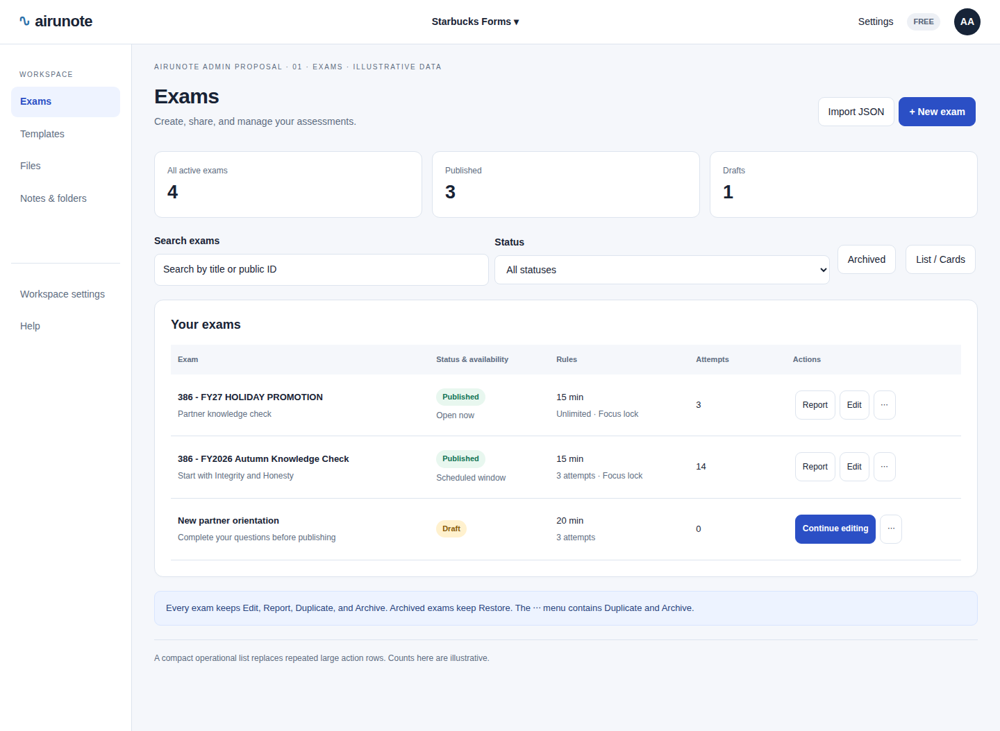

[Mobile drawing](screens/01-exam-library-mobile.png) · [Dark drawing](screens/01-exam-library-dark.png) · [HTML](01-exam-library.html)

**Purpose:** Find an exam, create one, monitor it, or manage its lifecycle.

Place **New exam** beside the heading. Retain both JSON entry methods under a visible Import JSON entry point: upload a file or paste/edit the template. Keep blank creation available without selecting a template first.

Default desktop list columns: title, publication/availability, rules, attempt count, and actions. Preserve direct Edit and Report access. Duplicate and Archive move into the labeled overflow menu. The menu remains keyboard accessible and does not depend on hover. Card view remains an option rather than being removed.

Add search by title/public ID and status filters. These are proposed new presentation features, not already implemented. Use client-side filtering only if the current metadata includes the required fields; do not invent question counts or schedule summaries in the list when the endpoint does not return them.

Archived is a distinct view with Restore and preserved records. On mobile, render equivalent cards with status, complete title, rules, count, Edit/Report, and overflow. The drawing intentionally keeps a contained table as a capability-preserving fallback; responsive cards are the recommended production treatment.

**Quality bar:** Find and edit/report an existing exam quickly; creation remains one obvious action; archiving and restoration are predictable.

### 02 — Exam details

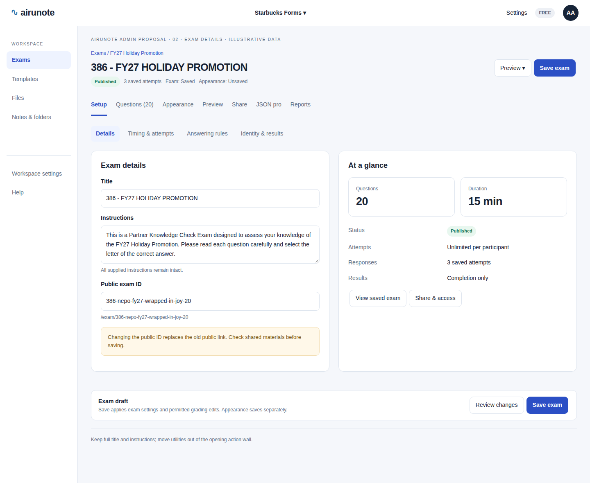

[Mobile](screens/02-exam-details-mobile.png) · [HTML](02-exam-details.html)

Keep Title, Instructions, and Public exam ID in one coherent form. Full instructions remain editable and readable. A summary panel shows the draft's relevant configuration without adding another source of truth.

The link warning stays directly beside the public ID. Preserve current lowercase/hyphen normalization and 3–80-character rules. On changed IDs, show old and proposed URLs before saving. Do not claim redirect aliases exist: the current help says the old link is replaced.

The summary uses real saved-attempt count and real question count, excluding entry fields from exam-question count. Its links open the relevant settings subsection.

**Quality bar:** Admins understand what they are editing, what remains unsaved, and whether a public-link change will affect shared material.

### 03 — Timing and attempts

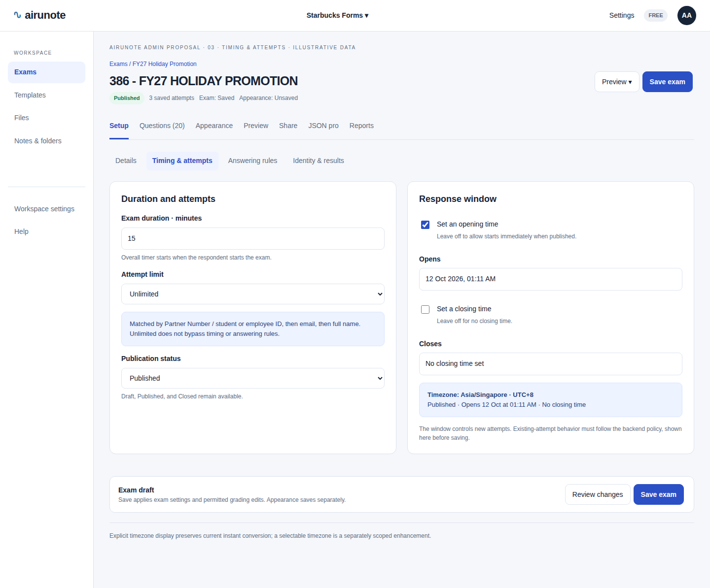

[Mobile](screens/03-timing-attempts-mobile.png) · [HTML](03-timing-attempts.html)

Group duration, unlimited/limited attempts, status, and response-window settings. Keep the unlimited value's existing semantics (`maxAttempts = 0`). When Limited is selected, show the existing maximum-attempt field; do not reset a previously entered value unnecessarily.

Retain the matching rule: identifier first, then email, then name. This affects how the cap applies, so it belongs next to the attempt control.

Display the actual device timezone and UTC offset beside date inputs, and summarize the opening/closing instants in readable text. “Asia/Singapore” is illustrative for this user's timezone; implementation must use the actual selected/device zone. The baseline proposal does not introduce arbitrary timezone selection or alter stored ISO timestamps.

Validate invalid duration, attempts, closing-before-opening, and invalid date input before saving. Distinguish no opening time, no closing time, Draft, Published but upcoming, Published but ended, and explicitly Closed. Verify and explain the backend's existing-attempt policy rather than silently changing it.

**Quality bar:** An admin can correctly predict when a respondent can start and how attempts are counted.

### 04 — Answering rules

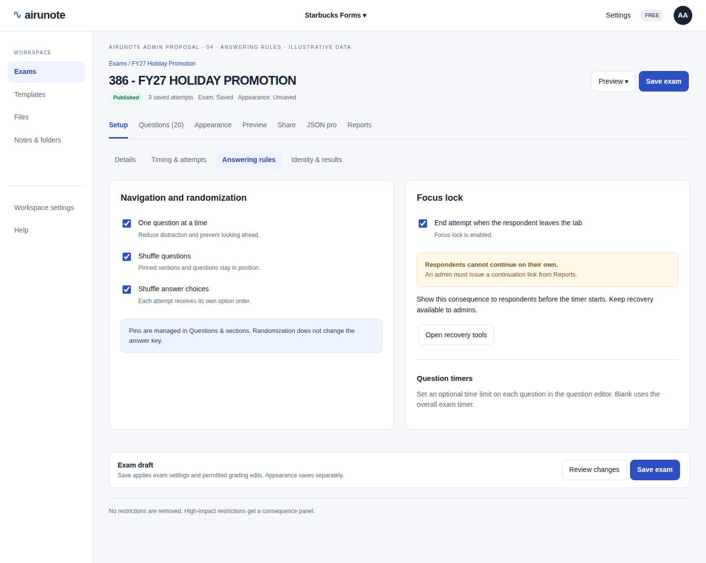

[Mobile](screens/04-answering-rules-mobile.png) · [HTML](04-answering-rules.html)

Keep all four controls: one question at a time, focus lock, shuffled questions, and shuffled choices. Pins remain managed with sections/questions and retain their ordering behavior.

Give focus lock its own consequence panel: leaving the tab ends the attempt and requires an admin continuation link. Do not rename it in a way that conceals this consequence. Explain known mobile interruption behavior only after verification; do not promise interruptions are harmless.

Show a contextual link to question timers; the actual timer stays per question. Optional practice/assessment presets from the initial review are deferred: presets risk changing an exam's approved rules unexpectedly and are not needed to improve clarity.

**Quality bar:** Strict rules are deliberate decisions, and recovery remains discoverable.

### 05 — Identity and results

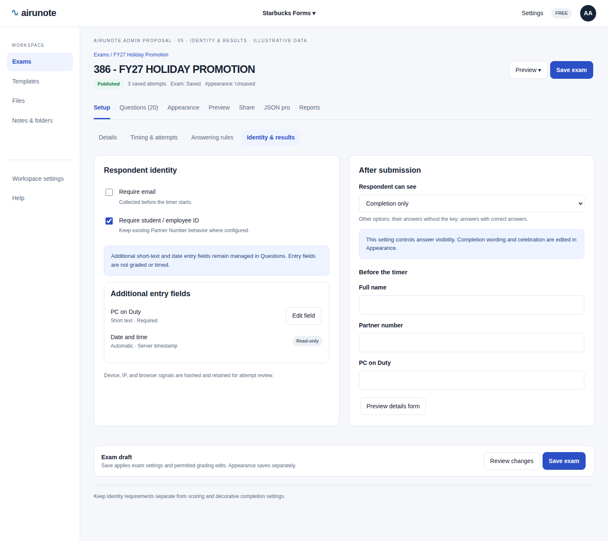

[Mobile](screens/05-identity-results-mobile.png) · [HTML](05-identity-results.html)

Keep required email and identifier toggles. Show connected entry-field summaries and a details-form preview. Entry fields remain part of the definition contract; this view links to their editor rather than duplicating storage.

Preserve the server-recorded date/time entry behavior. Do not present an automatically recorded timestamp as a respondent-editable field. Do not introduce configurable identifier labels as if they already exist; that is a possible future contract change.

Retain all three after-submission modes: completion only; respondent answers without correct answers; answers with the correct answers. Connect this setting to Completion appearance with a link, keeping answer visibility distinct from decorative wording.

**Quality bar:** Admins can predict the exact identity form and post-submission information respondents receive.

### 06 — Question builder

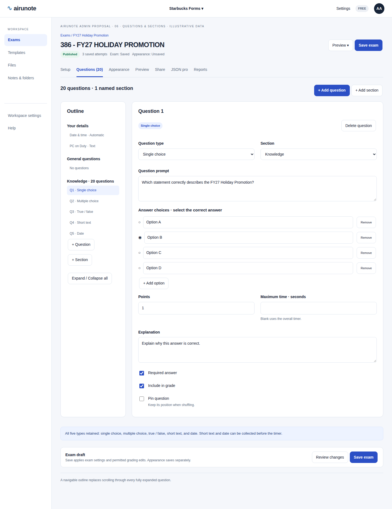

[Mobile](screens/06-question-builder-mobile.png) · [Dark](screens/06-question-builder-dark.png) · [HTML](06-question-builder.html)

A desktop outline identifies entry fields, General questions, named sections, question types, and selection. The active question exposes its full editor. Keep a list/expand-all mode so power users can compare several questions without repeatedly switching focus.

Every existing field stays available: prompt, type, section, pinned state, choices, correct-answer selection, accepted short/date answer, points, maximum time, explanation, required answer, and include-in-grade. All five types remain: single choice, multiple choice, true/false, short text, date.

Short text and date retain “collect before timer” behavior and its ungraded/untimed constraints. New questions remain ungraded until configured according to the current creation behavior; do not auto-invent keys.

Keep Add option, Remove option, Add question here, Delete question, Add section, Expand all, Collapse all. On mobile, the outline becomes a selectable drawer/sheet; a question editor uses the full width. No page-wide horizontal overflow is acceptable even with long prompts or labels.

**Quality bar:** Large exams are navigable without losing editing depth or content.

### 07 — Sections and grading locks

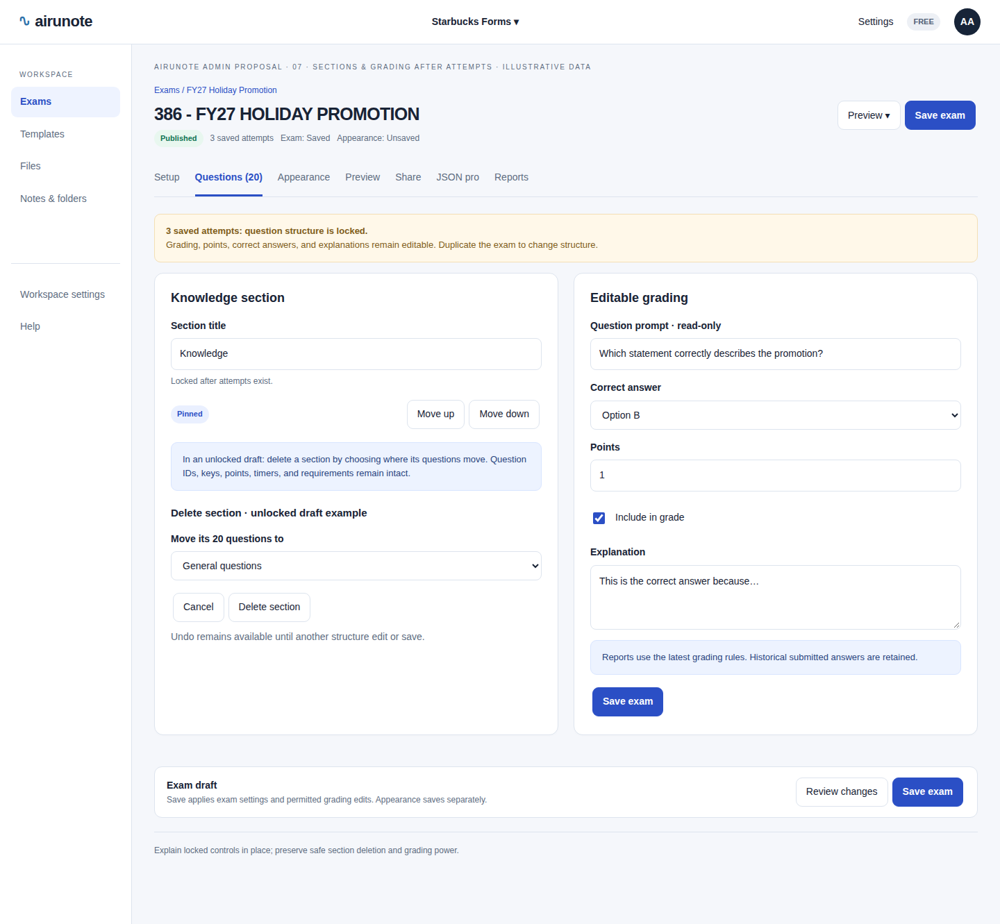

[Mobile](screens/07-sections-and-grading-mobile.png) · [HTML](07-sections-and-grading.html)

This drawing shows two workflow contexts together for comparison: an unlocked draft section-deletion example and grading after attempts exist. The deployed UI must enable only the actions valid for the current exam.

Keep optional named sections, General first, rename, up/down reorder, pin, expand/collapse, and safe deletion. Populated deletion asks where questions move; empty deletion is reversible immediately. Keep current default destination, stable question IDs, ordering, options, keys, timers, requirements, and pins. Undo remains limited by later edits/save, as currently designed.

After attempts exist, explain structure locks beside disabled controls. Keep correct answers, graded state, points, and explanations editable. Offer Duplicate as the way to reorganize a new exam. Do not make a duplicate silently or unlock historical question structure.

**Quality bar:** Section operations preserve every question, and admins understand why structural edits differ from grading edits.

### 08 — Appearance theme

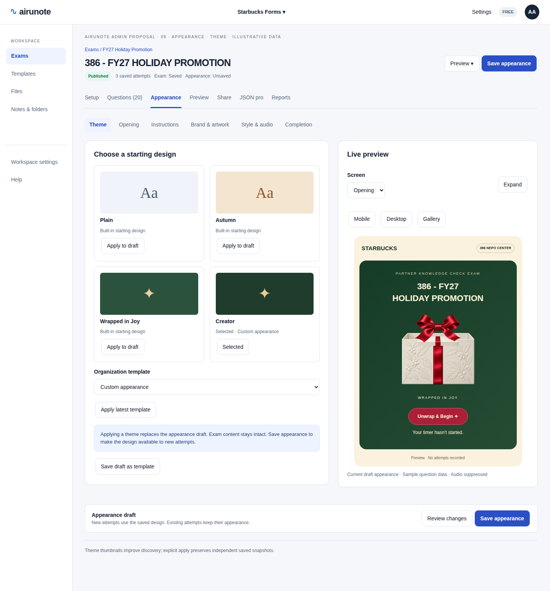

[Mobile](screens/08-appearance-theme-mobile.png) · [Dark](screens/08-appearance-theme-dark.png) · [HTML](08-appearance-theme.html)

Use thumbnails for Plain, Autumn, Wrapped in Joy, and Creator starting designs, plus saved organization templates and Custom. Their actual selection semantics must be preserved: some built-in choices replace a full configuration, while the current Creator selection preserves selected logo/caption values. The proposal must not flatten these into an indiscriminate replacement operation.

Show exactly what applying a choice changes. Offer recovery of the previous draft if practical. Applying latest template remains explicit and unavailable for an archived/unavailable template. Save draft as new template stays separate from saving the exam appearance.

At desktop width, preview remains alongside settings. At mobile width, keep a clear Edit/Preview switch with draft retention; the long full-page drawing shows all information for review, not a requirement to force both panels into one scroll.

**Quality bar:** Templates speed customization while leaving existing exams and attempts independent.

### 09 — Gift opening

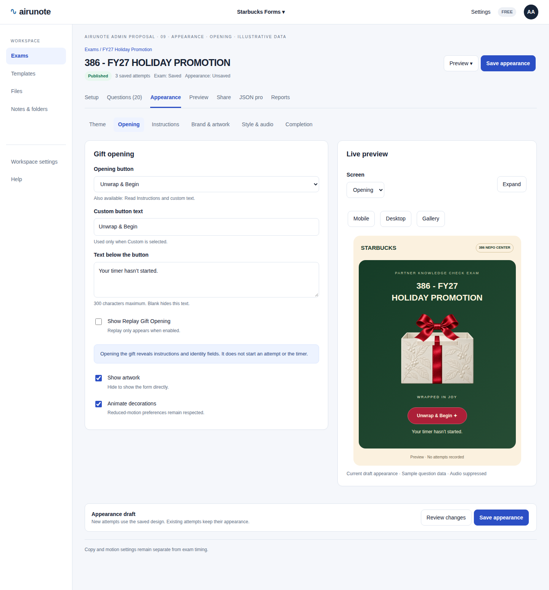

[Mobile](screens/09-appearance-opening-mobile.png) · [HTML](09-appearance-opening.html)

Keep the button modes Unwrap & Begin, Read Instructions, and custom text. Show custom text only in its relevant mode in the real implementation. The drawing includes it to document the retained capability.

Keep helper text, its 300-character limit, blank-to-hide behavior, and Replay visibility. Preserve gift reveal behavior, existing layers/assets/timings, and reduced motion. Hiding artwork keeps the form-direct behavior. Gift opening still does not start the timer or an attempt.

Replay and animation controls should explain their respondent effect. Do not reintroduce respondent mute controls removed by the handover.

**Quality bar:** An admin can customize the opening without misunderstanding when assessment timing begins.

### 10 — Instructions appearance

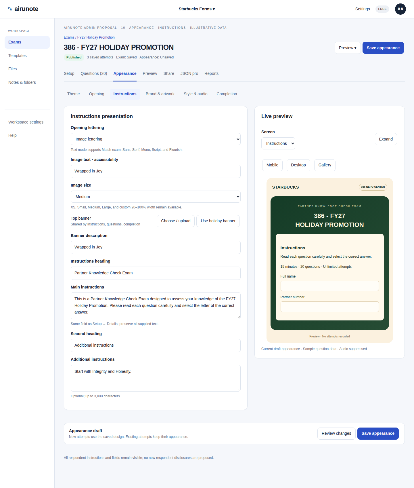

[Mobile](screens/10-appearance-instructions-mobile.png) · [HTML](10-appearance-instructions.html)

Keep text/image lettering, built-in ribbon-W selection, organization image selection, alternative text, XS/Small/Medium/Large/custom sizing, and custom 20–100% width. Text mode keeps Match exam, Sans, Serif, Mono, Script, and Flourish.

Keep optional instruction heading, opening text, secondary heading/body, and shared banner selection/reset/description. Main instructions reference Setup's existing field; do not create a second editable copy that can drift. The mockup displays the content together to show the proposed relationship, but a production first pass can link to the main field rather than merge persistence domains.

All supplied instructions and identity fields remain fully visible in the respondent experience. The banner stays shared across instructions, questions, and completion. The drawing uses simplified content to represent the placement; actual copy must remain complete.

**Quality bar:** Typography and artwork controls are connected to visible outcomes without hiding instructional content.

### 11 — Brand and artwork

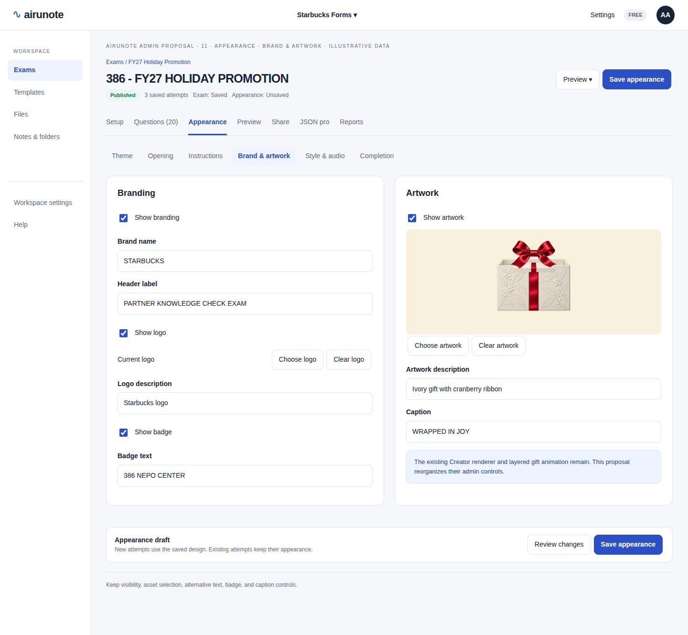

[Mobile](screens/11-brand-and-artwork-mobile.png) · [HTML](11-brand-and-artwork.html)

Keep branding visibility, brand name, header label, logo visibility, chooser, clear, description, badge visibility/text. Keep artwork visibility, chooser, clear, description, and caption.

Show chosen-asset thumbnails, source, and accessibility description. Asset removal means clearing this reference, not deleting the file from the organization. Library deletion remains a separate usage-aware operation.

**Quality bar:** Admins know which asset is selected, where it appears, and how clearing differs from deletion.

### 12 — Style and audio

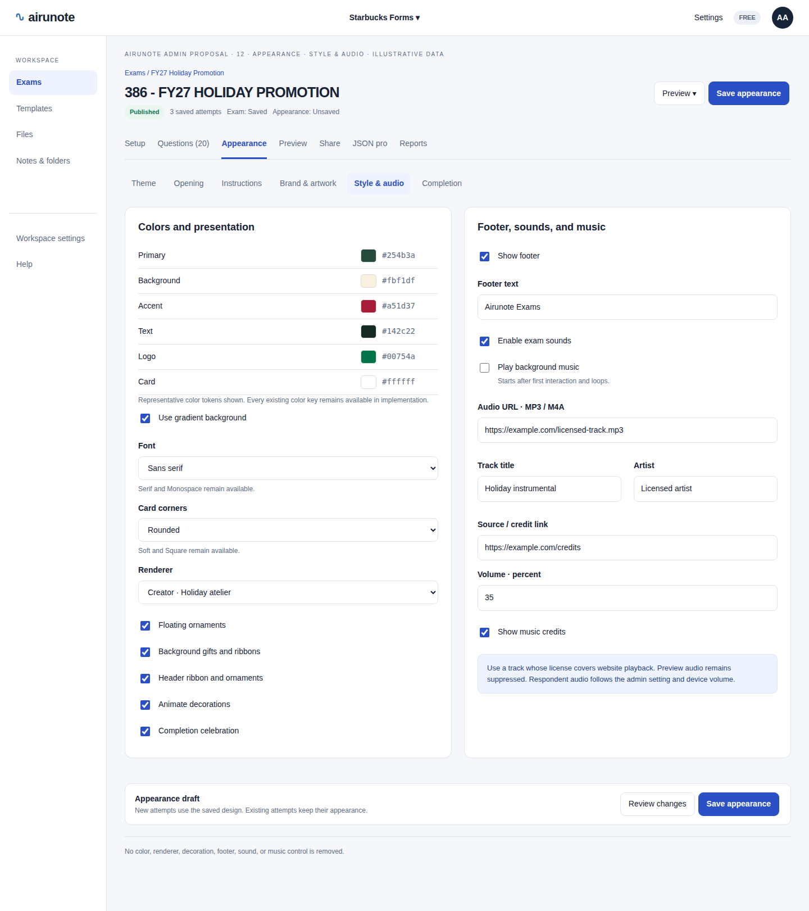

[Mobile](screens/12-style-audio-mobile.png) · [HTML](12-style-audio.html)

Keep every color key from the appearance contract. The drawing shows representative tokens only; it is not an exhaustive replacement list. Preserve gradient, font, rounding, renderer, and all decoration booleans: leaves/ornaments, background branches/gifts, header branches/ribbons, animation, completion celebration.

Keep footer visibility/text, exam sound availability, and every background-music setting: enabled, URL, title, artist, source/credit URL, volume, and credit visibility. Preserve first-interaction start, looping, preview suppression, and device-volume behavior.

Use a range slider with a numeric percentage display for volume. If invalid URLs or unavailable playback occur, keep the configuration and explain the error. Any playback audition control would be a new feature requiring separate verification, not an existing capability assumed here.

**Quality bar:** Styling stays flexible and audio decisions remain deliberate and predictable.

### 13 — Completion

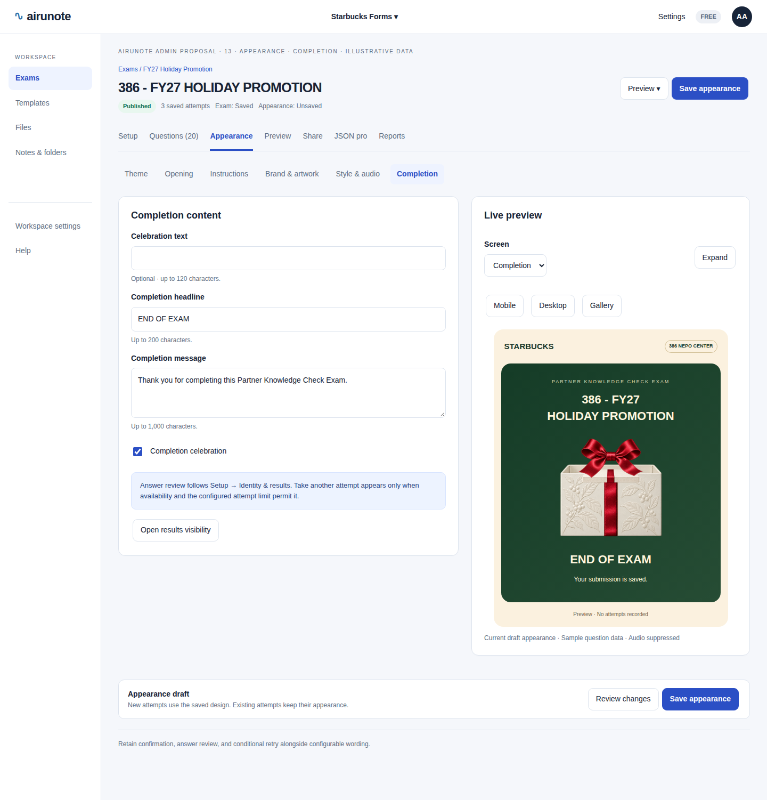

[Mobile](screens/13-completion-mobile.png) · [HTML](13-completion.html)

Retain celebration text (120 characters), completion title (200), message (1,000), and celebration preference. Preserve END OF EXAM defaults and existing rendering normalization.

Show a saved-submission confirmation, keep answer review controlled by review mode, and keep Take another attempt conditional on remaining allowance and availability. A visual preview does not create an actual submission or unlock real retry behavior.

**Quality bar:** Admins can distinguish completion copy, saved-confirmation truth, answer visibility, and retry eligibility.

### 14 — Preview studio and gallery

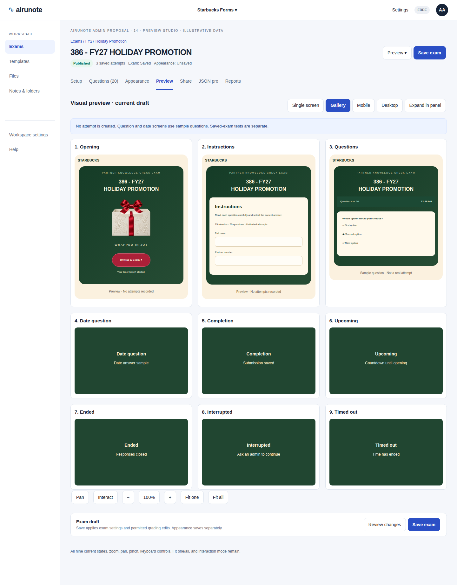

[Mobile](screens/14-preview-gallery-mobile.png) · [HTML](14-preview-gallery.html)

Current source has **nine** visual states: Opening (`entry`), Instructions, Questions, Date question, Completion, Upcoming, Ended, Interrupted (`terminated`), and Timed out. This supersedes the older handover's eight-state count.

Keep Previous/Next, screen selector, phone/desktop, gallery/single, expanded in-panel presentation, Escape restoration, and focus restoration. Keep drag pan, touch pinch, wheel/trackpad zoom, keyboard +/−/0, Fit one, Fit all, and Pan/Interact modes. Do not replace expansion with browser-native fullscreen: the handover explicitly preserves the adjacent chat.

The static contact-sheet drawing makes all states inspectable. Production gallery should retain the existing freely translated/scaled canvas and controlled gestures. In single view, interaction remains available for the gift and form. Do not reduce it to static thumbnails.

Visual-preview labels state that current appearance and supported entry settings are used, while question/date screens use samples. The saved admin test remains separate. No “preview creates no attempts” banner may be applied to a route that does create test records.

**Quality bar:** Admins know what is draft, what is saved, what is sampled, and what creates records.

### 15 — Share and access

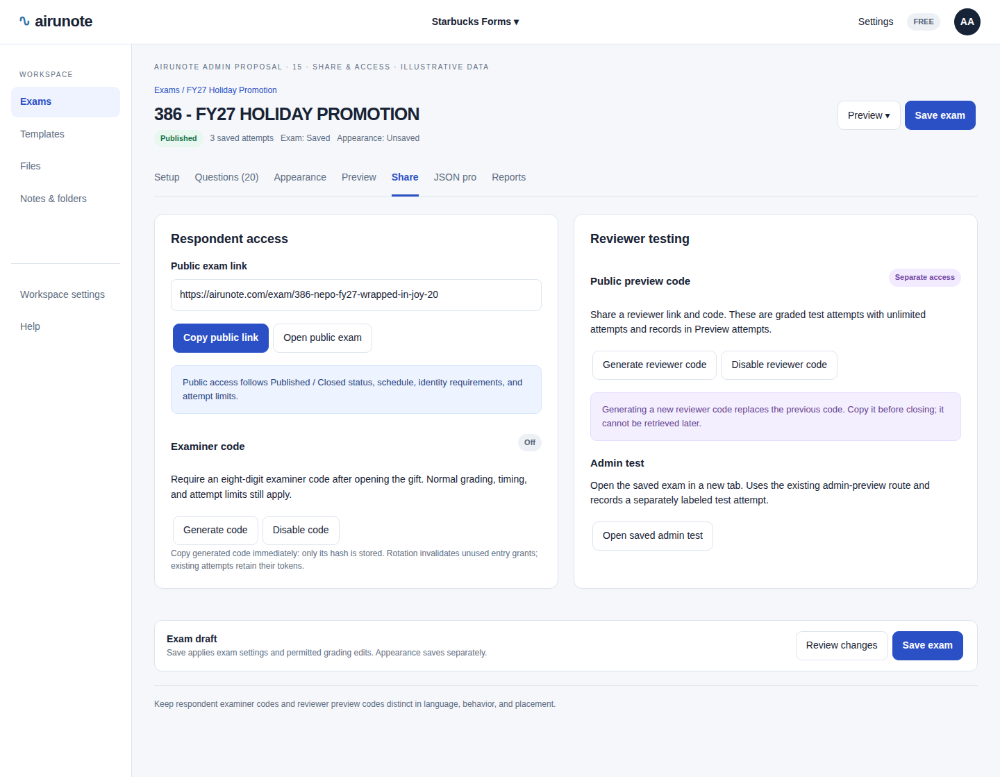

[Mobile](screens/15-share-access-mobile.png) · [HTML](15-share-access.html)

Separate respondent access from reviewer testing. Retain Copy public link and Open public exam. Clearly report unsaved public-ID changes: public-link copy should use the saved identifier until saving succeeds, or explicitly say it is copying a proposed unsaved link.

**Examiner code:** generate/rotate and disable; eight digits; hash-only storage; copy immediately. It gates on-site respondent entry and retains published status, schedule, normal limits, and timing. Rotation invalidates unused entry grants, not existing attempt tokens.

**Public reviewer preview code:** generate/rotate and disable; reviewer link and code; graded unlimited test attempts recorded separately. Explain previous-code invalidation and copy-once behavior.

**Admin saved test:** authenticated existing route, separate test record. Avoid labeling it a pure visual preview.

Loading or failed code-status requests must show Unknown / Could not load, not default Off. The current control can fail without displaying a status error; the proposed state fixes this ambiguity.

**Quality bar:** No confusion between restricting real respondents and inviting reviewers to test.

### 16 — JSON pro

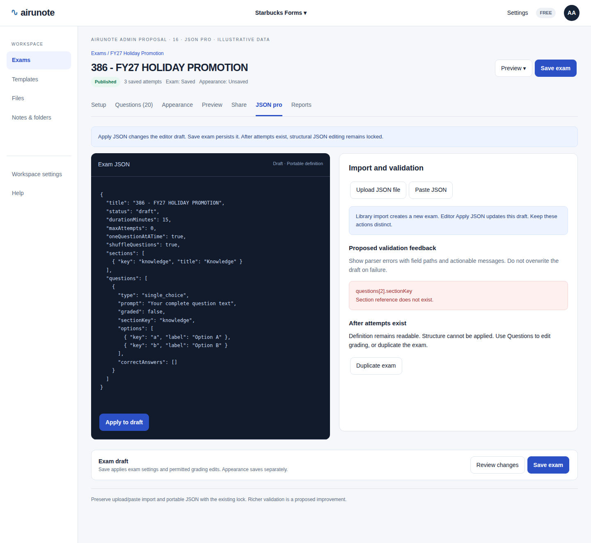

[Mobile](screens/16-json-tools-mobile.png) · [HTML](16-json-tools.html)

Keep the portable definition editor, file import, pasted template, Apply, and Save distinction. Library import creates a new exam; editor Apply changes this draft. Applying valid JSON should keep normalized structure and then require Save exam.

After attempts exist, structural JSON remains locked/readable and directs permitted grading edits to Questions. Never enable an Apply path that bypasses the structure lock.

Parser field paths, line information, richer validation, and a read-only export/download shortcut are useful potential enhancements. Only claim line highlighting if an actual editor/parser supports it. The mockup shows a proposed actionable field error, not current diagnostic output.

Keep un-applied JSON text when switching views or leaving the page, or warn that it will be discarded. The current text buffer is distinct from the applied draft; protecting only the applied exam draft is insufficient for a complete UX. This is a targeted implementation task, not a new persistence model.

**Quality bar:** Power users work quickly without accidental replacement, silent loss, or confusing persistence.

### 17 — Live reports

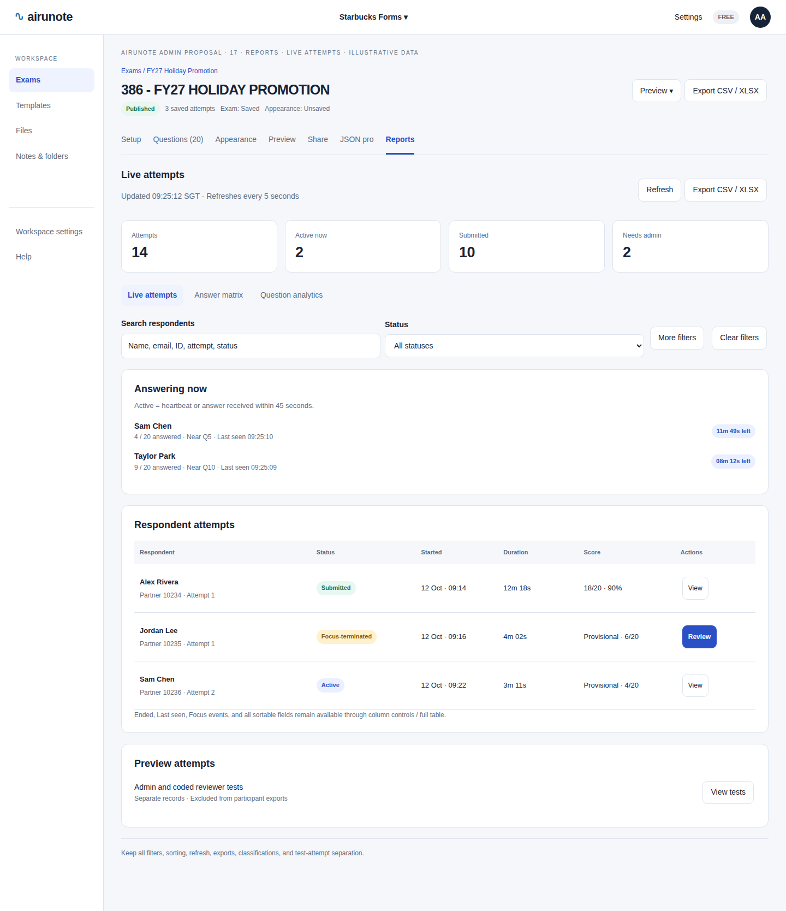

[Mobile](screens/17-live-reports-mobile.png) · [Dark](screens/17-live-reports-dark.png) · [HTML](17-live-reports.html)

Keep Attempts, Active now, Submitted, and Needs admin summary filters. Retain five-second refresh, last-updated timestamp, manual refresh, answering-now progress, remaining time, active question, and 45-second heartbeat definition.

Keep every filter: text search, status, min/max percentage, completed date, focus events, needs review, include voids, clear. Keep all classifications: active, inactive/stale, focus-terminated, timed out, abandoned, submitted, interrupted/terminated, void.

Keep every sortable field: respondent, status, started, ended, last seen, duration, percentage, focus count. The drawing prioritizes a subset of columns; the production full table/column controls must expose all of them. No inaccessible hidden columns.

Separate participant Attempts and Preview attempts. Preserve provisional score labels, pending grade, and void reasons. Retain current preview exclusion from participant exports. CSV exports filtered participant rows; XLSX also includes question analytics. Explain that distinction rather than implying the entire workbook is filtered identically.

Date filters should state the timezone basis. The source completion-date comparison uses an ISO date slice while display is device-local; align or explicitly label this basis during implementation.

**Quality bar:** An admin can monitor live activity, identify intervention, and export the expected population without losing data visibility.

### 18 — Attempt review and recovery

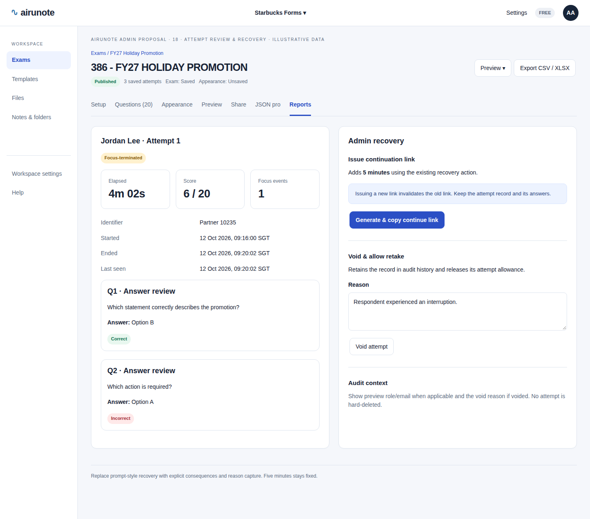

[Mobile](screens/18-attempt-review-mobile.png) · [HTML](18-attempt-review.html)

Retain name, email/identifier, attempt number, classification, duration, start/end/last-seen, focus events, answers, correct/incorrect/unscorable outcomes, preview role/email, and void reason.

A desktop drawer or focused dialog keeps report context. Mobile uses a full-height sheet with an accessible close action. Return focus to the original row on closing. Keep complete question and answer text.

Continuation remains eligible-only and adds the current fixed five minutes. Explain that generating a new link invalidates the old link. If copying fails after link generation, display a copyable link rather than falsely reporting generation failure or regenerating automatically.

Void requires a reason, retains history, and releases allowance. Never offer hard deletion. Confirmation describes the specific respondent/attempt. Do not introduce bulk voiding as a cosmetic redesign.

**Quality bar:** Recovery is understandable, auditable, and does not lose records or links.

### 19 — Answer matrix

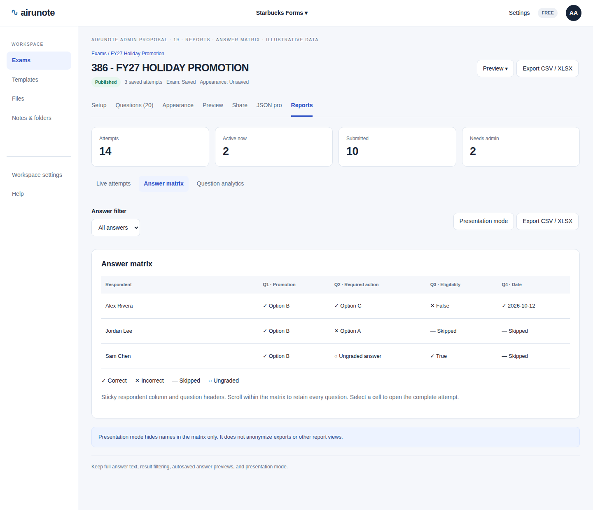

[Mobile](screens/19-answer-matrix-mobile.png) · [HTML](19-answer-matrix.html)

Keep sticky headers/identity column, correctness heatmap, autosaved answers, result filter (all/correct/incorrect/skipped), full text inspection, and attempt opening. Add text/symbol legend so correctness is not communicated by color alone.

Retain ungraded and skipped distinctions. A blank or unscorable answer is not automatically an incorrect answer. Keep the table horizontally scrollable within its own region, not the entire page. On mobile, a question-focused inspection view can supplement—not replace—the full matrix.

Presentation mode hides matrix names only. Explicitly warn that it does not anonymize exports or other report screens. Do not oversell it as global privacy mode.

**Quality bar:** Dense cross-question analysis remains powerful and understandable at every width.

### 20 — Question analytics

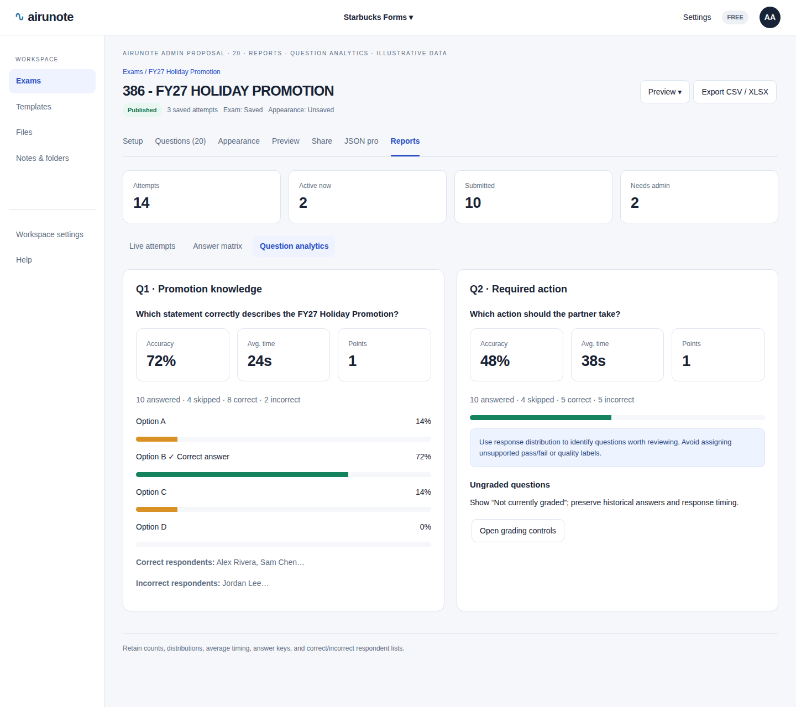

[Mobile](screens/20-question-analytics-mobile.png) · [HTML](20-question-analytics.html)

Keep prompt, grading state, points, answered/skipped/correct/incorrect counts, accuracy, average seconds, option counts/percentages, correct-option indicator, and respondent lists. Link to allowed grading editing without inventing automatic correction recommendations.

Ungraded items retain historical answers and timing. Do not represent unavailable accuracy as zero or label a question “bad” solely because accuracy is low. The proposed cards favor comparison while leaving full text and participant lists accessible.

**Quality bar:** Admins can understand both answer distribution and scoring status before changing a key.

### 21 — Organization templates

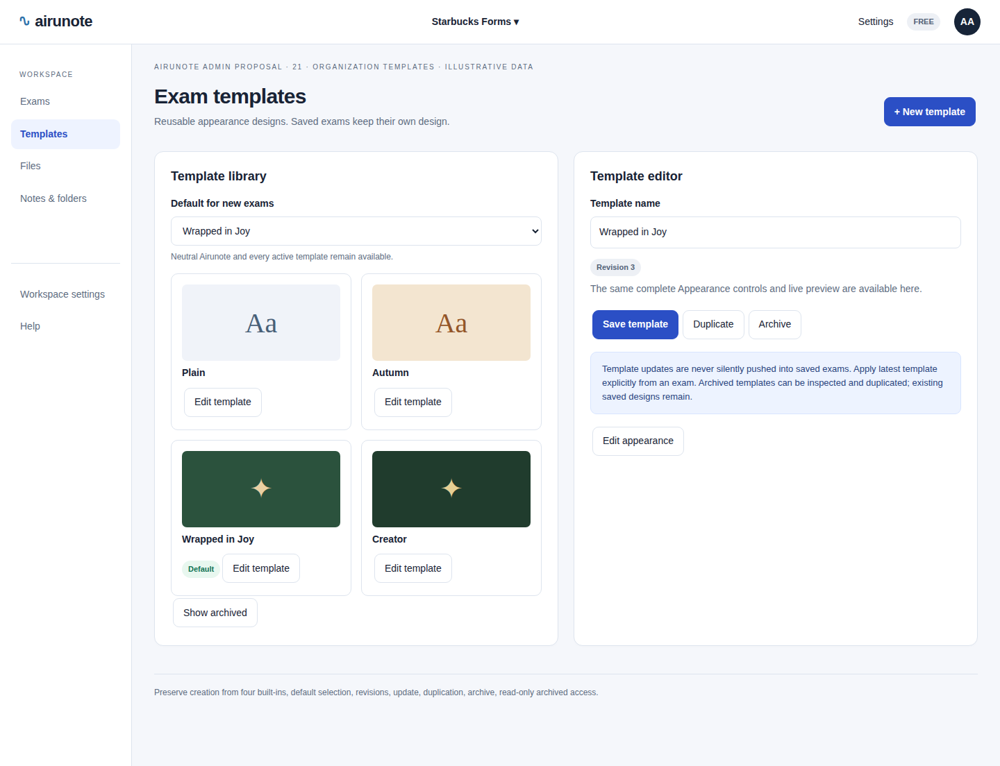

[Mobile](screens/21-templates-mobile.png) · [HTML](21-templates.html)

Retain creation from Plain, Autumn, Wrapped in Joy, and Creator; name editing; saved revisions; full appearance editor/preview; update; duplication; archive; organization-default selection; neutral default; archived inspection and duplication.

Only permitted admins can mutate templates. Archived templates stay read-only; don't invent a restore action that is not in the current template UI. Default changes affect new exams. Existing exams remain independent. Applying latest revision stays an explicit exam-level draft action.

**Quality bar:** Reuse saves time without silently changing live exams or historical attempts.

### 22 — Files and image chooser

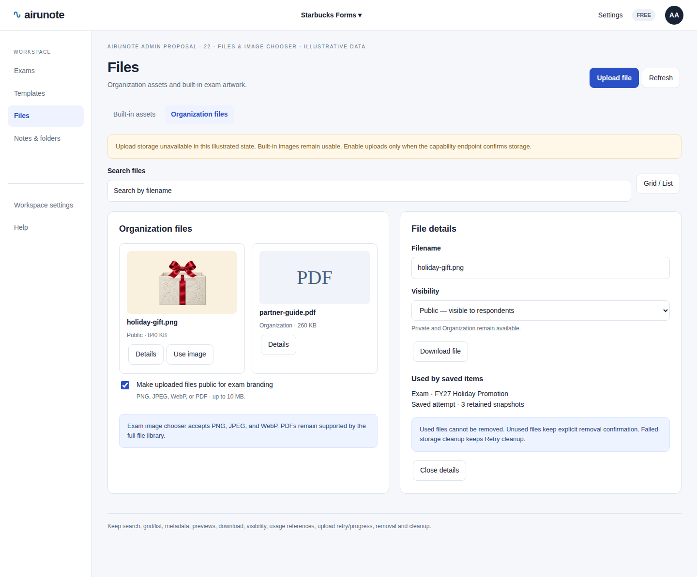

[Mobile](screens/22-file-library-mobile.png) · [HTML](22-file-library.html)

Keep built-in and organization sources, search, grid/list, refresh, image/PDF preview, download, filename/type/size/visibility, upload public preference, progress, retry, usage details, visibility changes, unused removal confirmation, and cleanup retry.

The full library supports PNG/JPEG/WebP/PDF up to 10 MB. Exam chooser restricts selection to supported public images. Organization/private files remain available for their proper uses; they are not silently made public.

Show actual upload capability. If storage is unavailable, disable Upload with the reason while leaving built-ins usable. The drawing intentionally illustrates this unavailable state; it does not claim a fresh production capability check.

Used assets cannot be removed. Show template/exam/attempt usage and public-visibility consequences. Keep authorization and saved references unchanged. Do not introduce image cropping in this baseline proposal: cropping was a suggestion in the initial visual review but is not an existing feature.

**Quality bar:** Admins can manage assets confidently without breaking saved appearance snapshots.

### 23 — Workspace journey

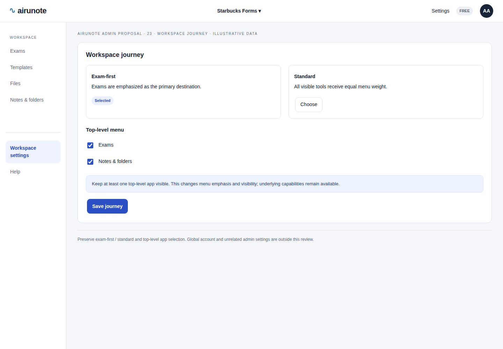

[Mobile](screens/23-workspace-settings-mobile.png) · [HTML](23-workspace-settings.html)

Retain Exam-first and Standard, Exams and Notes & folders menu selections, minimum one visible top-level app, Save journey, and metadata refresh. Explain when the last visible app cannot be deselected.

A simple menu preview is a possible UI enhancement. It must reflect the real shell, not imply the choice removes underlying functionality.

**Quality bar:** Organization navigation preferences are understandable and reversible.

### 24 — Important states

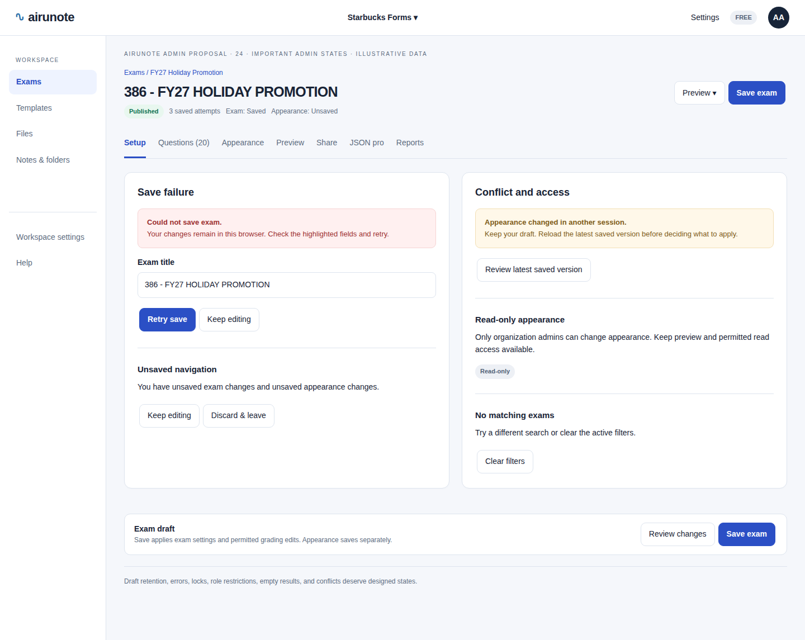

[Mobile](screens/24-important-states-mobile.png) · [HTML](24-important-states.html)

Design loading, save-in-progress, save failure, partial save, stale appearance revision, read-only access, unsaved navigation, empty library, filtered empty results, failed code-status load, failed clipboard copy, and missing upload storage. This drawing groups examples for review; they are separate states in the real product.

Retain every draft on failure. Navigation warning must account for exam changes, appearance changes, and un-applied JSON text. Keep editing and Discard & leave are clear. Do not offer Save & leave unless all dirty domains can be saved safely and individually confirmed as successful.

Conflict resolution starts by preserving the local draft and fetching the latest saved version. No silent overwrite or automatic merge is proposed.

**Quality bar:** Problems are recoverable without admins guessing whether work survived.

## 4. Capability preservation map

This is the implementation acceptance checklist. “Moved” means a new location or clearer label, not removal.

| Current capability | Proposed home | Required invariant |
|---|---|---|
| Blank creation | Library → New exam | Existing creation contract/defaults |
| Upload/paste JSON import | Library → Import JSON | Create a new exam; validate first |
| Edit / report / duplicate / archive | Library rows/cards | Every action remains accessible |
| Archived list / restore | Library → Archived | Retain exams and attempt history |
| Full title / instructions / public ID | Setup → Details | Preserve content; expose link replacement |
| Draft / Published / Closed | Setup → Timing | Saved versus draft status explicit |
| Duration | Timing | Existing 1–1,440-minute bounds |
| Unlimited / max attempts | Timing | Zero means unlimited; retain participant matching |
| Start/end windows | Timing | Optional open ends; preserve ISO instant storage |
| One-at-a-time / focus lock | Rules | Same participant enforcement/recovery |
| Question/choice shuffle | Rules | Same pins and correct-answer mapping |
| Email / identifier requirements | Identity | Same backend identity contract |
| Review modes | Identity & results | All three visibility modes |
| General / named sections | Questions outline | General first, named sections optional |
| Rename / reorder / pin section | Section controls | Existing order semantics |
| Safe section delete / move / Undo | Section controls | Preserve every question and stable identity |
| Expand / Collapse all | Questions toolbar | Retain multi-question power editing |
| Five question types | Active editor | Every type and type-specific key control |
| Choices add/remove / correct key | Active editor | Maintain key references |
| Points / grade / explanation | Grading | Editable after attempts exist |
| Prompt/type/options/structure locks | Questions + JSON | Locked after saved attempts |
| Question time limit | Active editor | Blank uses overall timer; existing bounds |
| Required / pin question | Active editor | Same ordering and validation |
| Entry short text / date | Entry fields | Ungraded and untimed; date server behavior |
| Portable JSON / Apply | JSON pro | Apply draft then Save; preserve locks |
| Appearance snapshots | Appearance | Existing attempts retain theirs |
| Custom + built-in starting styles | Theme | Preserve exact selection semantics |
| Apply latest template | Theme | Explicit; no silent propagation |
| Save as new template | Theme | Separate from Save appearance |
| Gift labels/helper/replay | Opening | Same optional contract and limits |
| Instruction text/image/fonts/sizes | Instructions | All alternatives and custom width retained |
| Banner chooser/reset/alt | Instructions | Shared across intended states |
| Secondary instruction block | Instructions | Optional; complete copy retained |
| Brand/logo/badge controls | Brand & artwork | Visibility, choose/clear, descriptions |
| Artwork/caption controls | Brand & artwork | Existing layered renderer unchanged |
| Every color / gradient / font / corners | Style | No token omitted |
| All four renderers/decorations | Style | No theme removed |
| Completion content | Completion | Existing defaults and field limits |
| Footer / sound | Style & audio | Existing visibility and sound behavior |
| Background music metadata/volume/credits | Style & audio | Same playback/license guidance |
| Nine preview screens | Preview studio | No state omitted |
| Single/gallery/phone/desktop/expanded | Preview studio | Expanded stays inside browser panel |
| Pan/Interact/pinch/wheel/keyboard/Fit | Preview studio | Preserve canvas interaction model |
| Copy public link | Share | Saved versus unsaved ID truthful |
| Examiner code generation/disable | Share → Respondents | Hash-only, eight digits, grant behavior |
| Reviewer code generation/disable | Share → Reviewers | Unlimited graded preview attempts, separate records |
| Saved admin test | Preview / Share | Existing authenticated test semantics |
| Live refresh/heartbeat monitor | Reports | Five seconds; 45-second active definition |
| Every filter/sort/classification | Reports | Full precision, no hidden inaccessible field |
| Attempts + PreviewAttempts | Reports | Separate test population |
| Detail / continuation / void | Attempt review | Eligibility, +5 minutes, retained records |
| CSV / XLSX | Reports → Export | Preserve current filter/population semantics |
| Full matrix + result filter | Answer matrix | All answers, skipped/ungraded distinctions |
| Presentation mode | Matrix | Names hidden there only |
| Full item analysis/respondent lists | Question analytics | Same reporting semantics |
| Templates/default/revisions/archive | Templates | No silent update of existing exam designs |
| File sources/upload/visibility/usage | Files | Same permissions and public-use rules |
| File progress/retry/cleanup/download | Files | Preserve failure recovery |
| Journey modes/menu preferences | Workspace settings | At least one visible top-level app |

## 5. Responsive behavior

| Width | Proposed behavior |
|---|---|
| 1,280–1,600+ px | Organization rail, full contextual header, two-column settings where useful, persistent appearance preview |
| 768–1,279 px | Narrow rail or collapsible navigation; header actions wrap; complex question/appearance views adapt to available space |
| 320–767 px | Organization navigation drawer; one-column forms; scrollable exam tab strip; outline sheet; explicit Edit/Preview switch |

Use natural page scrolling for long content. A sticky save bar is a production recommendation, with safe-area space and focus/keyboard accommodation; the drawings show its content at the end to keep full-page captures readable. Do not stack a fixed top header and bottom action bar so tall that the mobile form becomes unusable.

Wide report tables and matrices scroll inside labeled regions. Mobile respondent cards can expose important details with an accessible full-detail view; the matrix must remain available. At 200% zoom, controls wrap without losing actions. At 320px, long IDs/prompts cannot force page overflow.

Do not shrink the full title or body copy to unreadable sizes. Truncated list titles need an accessible full title in detail; editor titles wrap. Keep actual instructions intact rather than cutting copy to match a drawing's height.

## 6. Accessibility and interaction requirements

- Keyboard access to tabs, overflow menus, outline, code dialogs, file chooser, preview controls, and report actions.
- Visible focus; semantic labels; disabled controls explain why. Text fields have persistent labels, not placeholders alone.
- Dialogs trap focus, support Escape where appropriate, and restore focus. Generated secrets stay visible until deliberately dismissed.
- Save/error announcements use appropriate live regions; polling does not steal focus or repeatedly announce the whole report.
- 44px recommended touch targets for small/icon controls. Respect reduced motion for gift transitions and decoration.
- Contrast checks for light/dark admin surfaces and every configurable respondent theme. Correctness and status have text/symbols, not just colors.
- Native input behaviors remain usable; multi-choice answer-key selection does not impersonate respondent answering without a clear label.
- Gallery gestures coexist with keyboard controls; Interact/Pan mode is explicit and switchable.
- Reordering remains possible with buttons/keyboard even if drag-and-drop is later added.

## 7. What changes now, and what requires new product work

### Reorganization using existing contracts

Contextual header, clearer save labels, task navigation, grouped setup, appearance subsections, separate sharing sections, human-readable timezone display, better copy, direct grading/recovery links, deliberate lock states, template thumbnails, and capability-aware file messages can mostly reuse existing data and endpoints.

A question outline is a frontend interaction change. It must preserve expand-all and all editing operations. Unified unsaved protection requires coordinating the existing draft domains; it is more than cosmetic copy.

### Proposed additions that need implementation and verification

Library search/filter/list preference; advanced report filter panel/column selection; responsive attempt cards; structured recovery dialogs; parser field diagnostics; draft-change review; preserved unapplied JSON text; date-filter timezone alignment; richer code/clipboard recovery. These are design proposals, not current verified behavior.

### Deliberately outside the baseline

Autosave, atomic cross-domain saving, staged publication versions, new grading-history versions, arbitrary timezone selection, rule presets, configurable identifier contracts, image cropping, bulk destructive actions, automated question-quality judgments, and globally anonymized export. The improved layout does not require these features. They can be evaluated separately without weakening the existing system.

## 8. Implementation sequence

1. **Shared shell and save-state truth.** Build contextual navigation; report actions differ from editing actions; track all dirty domains; preserve lock/status semantics. Verify before styling every screen.
2. **Setup and Questions.** Reorganize settings, outline, mobile navigation, consequences, and entry-field linking. Exercise zero sections, populated/empty deletion, Undo, pinned ordering, and all question types.
3. **Appearance and Preview.** Group every field, preserve selection semantics, previews and snapshots; verify all renderers and nine states, gallery controls, reduced motion, and current gift continuity.
4. **Share, Reports, and recovery.** Preserve both code systems, polling/filter/export semantics, complete matrix and analytics, eligible continuation, void history, and clipboard failure recovery.
5. **Templates, Files, and workspace preferences.** Preserve permissions, default/archived behavior, usage references, unavailable storage, upload retry, and minimum menu selection.

Complete a coordinated implementation and focused smoke pass. Per repository instructions, cap full design/implementation/smoke cycles at three. No production deployment is part of this proposal.

## 9. Acceptance checks for the implemented redesign

### Must pass before release

- Every row in the capability map has a reachable control and the same authorization/backend constraints.
- No existing title, instruction, prompt, option, key, template, appearance snapshot, exam, attempt, or answer changes through presentation-only migration.
- Create/import/duplicate/archive/restore still work, with failed operations recoverable.
- Exam and appearance saved/unsaved states stay independent across tab switches, reload warnings, save failures, and conflicts.
- Draft publication state is never mistaken for actual public state.
- Unapplied JSON text is protected; invalid JSON cannot replace the draft.
- Grading remains editable after attempts; structural editing remains locked, including JSON.
- Safe section deletion preserves IDs/order/keys/timers/requirements/pins and correct Undo behavior.
- Preview distinguishes current draft/sample renderings from saved test attempts. All nine visual states remain reachable.
- Template changes never propagate silently. Existing attempts preserve saved appearance.
- Reviewer and examiner codes retain distinct permissions, record behavior, rotation, grant, and hash-only rules.
- All reporting filters/sorts/columns, separate preview records, CSV/XLSX, and detail/recovery actions remain available.
- Continuation adds five minutes only when eligible; void releases allowance while retaining history/reason.
- Files keep visibility/usage controls and built-ins usable when uploads are unavailable.
- 320, 390, 768, and 1440px show no page-wide horizontal overflow; mobile question and recovery states are inspected.
- All admin theme states and Plain/Autumn/Holiday/Creator respondent previews are checked; contrast and reduced motion remain usable.

### Usability targets to validate with real admins

These are targets, not measured achievements:

- Locate an existing exam and open Edit or Report without searching repeated action rows.
- Explain whether exam changes and appearance changes are saved after one glance at the header.
- Set a schedule and correctly state its timezone and respondent opening behavior.
- Change a permitted grading key and understand its effect on reports.
- Generate the correct code type without confusing reviewer tests with respondent access.
- Recover an interrupted attempt without losing the original record or continuation link.
- Inspect all preview states and return to editing without losing changes.

## 10. Deliverables and validation

- [Visual index](index.html): links to all 24 standalone HTML drawings.
- [Screen manifest](screens.json): titles and purpose of every drawing.
- `screens/`: desktop/mobile PNGs for every proposed view, plus four dark examples.
- [Mockup source generator](build-mockups.cjs): reproducible HTML/CSS drawings.
- [Renderer](render-mockups.cjs): local Playwright capture and overflow/image checks.
- [QA measurements](qa.json): per-screen checks at 320, 390, 768, 1440px and a dark desktop check.

During preparation of this original proposal, no application source was edited. The pre-existing uncommitted change in `frontend/app/globals.css` was preserved. During the proposal work, no backend was started, no authenticated data was saved, and no deployment was attempted. The subsequent local implementation is documented in the linked test guide.

Mockup validation is recorded separately from product validation. These drawings are a reviewable design specification. They do not prove authenticated application flows, real report calculations, permissions, production uploads, or physical device gestures.

### Completed mockup checks

120 browser measurement checks passed: every one of the 24 drawings at 320, 390, 768, and 1440px, plus dark desktop rendering. No page-wide overflow, broken referenced images, or light-view JavaScript page errors were detected. Four representative captures were visually inspected: desktop library, mobile question editor, desktop appearance editor, and dark live report. This is mockup QA, not live-product integration validation.

### All-screen contact sheets

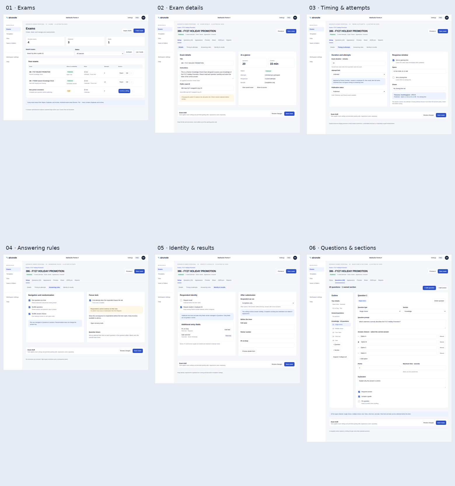

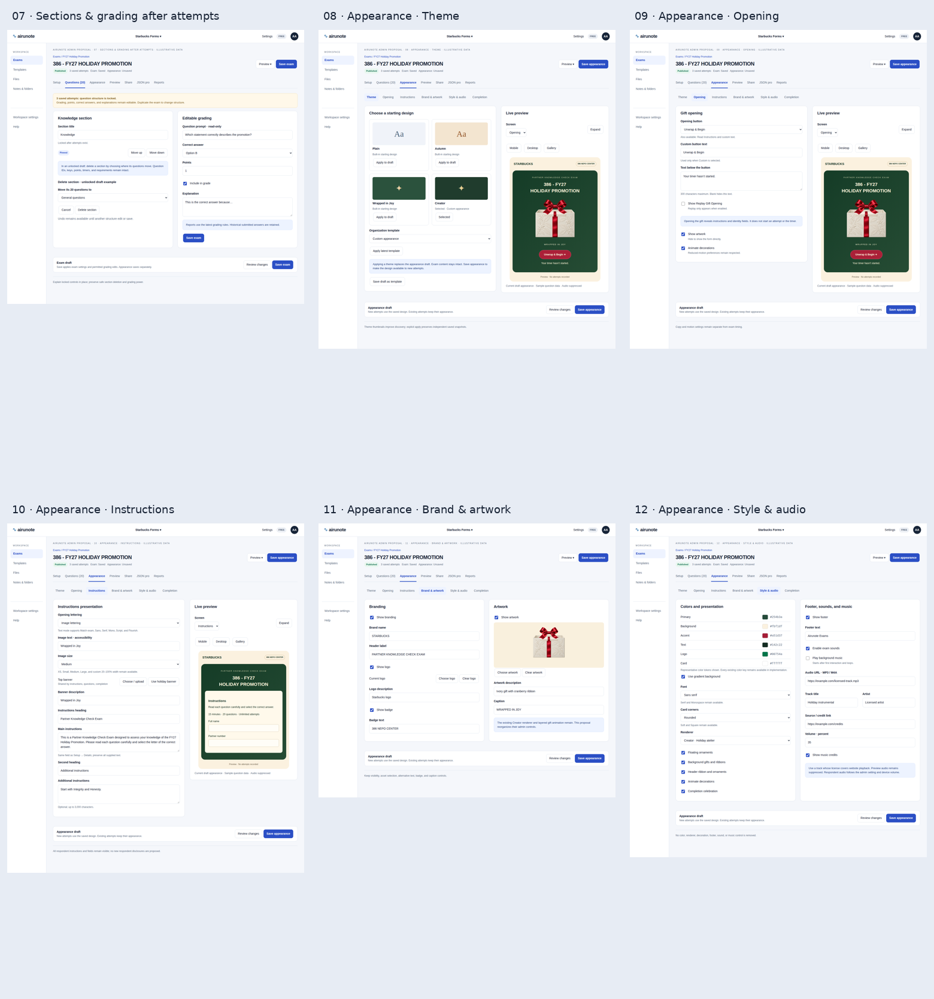

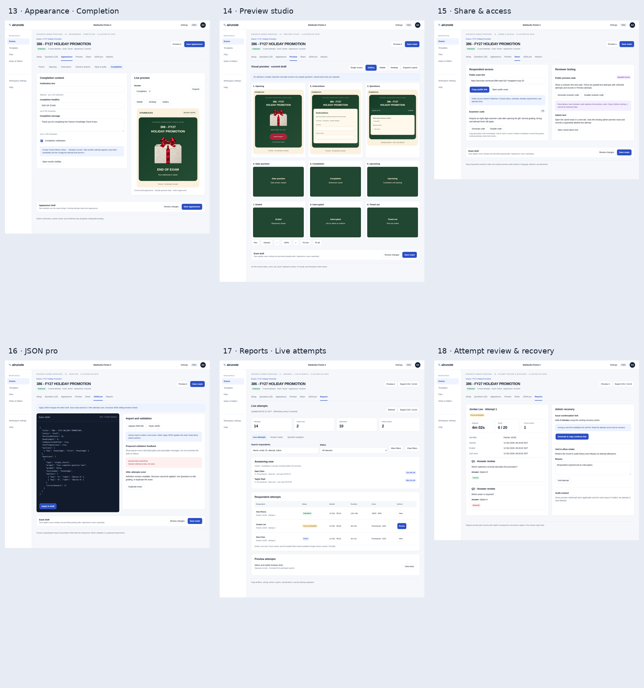

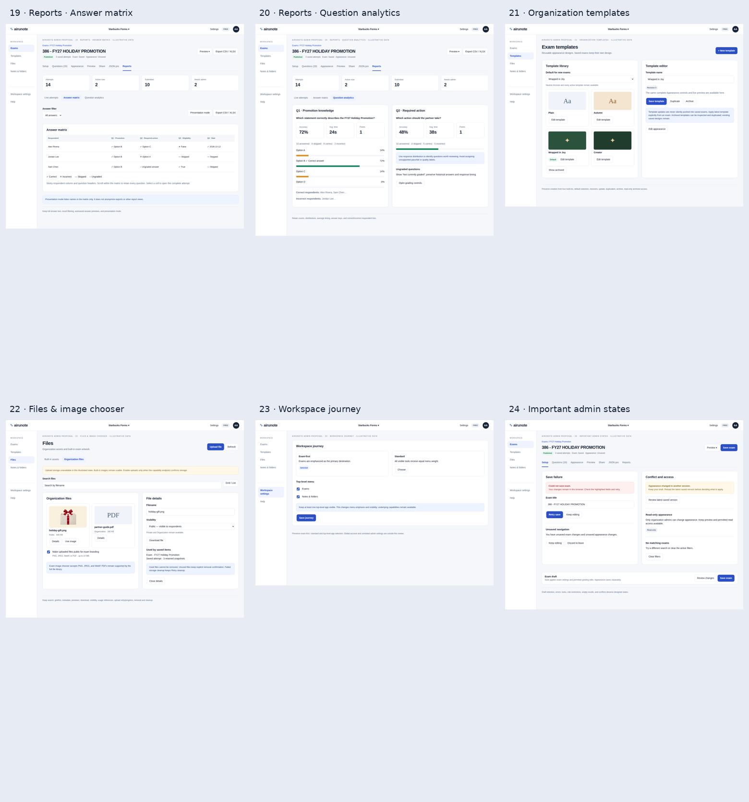
