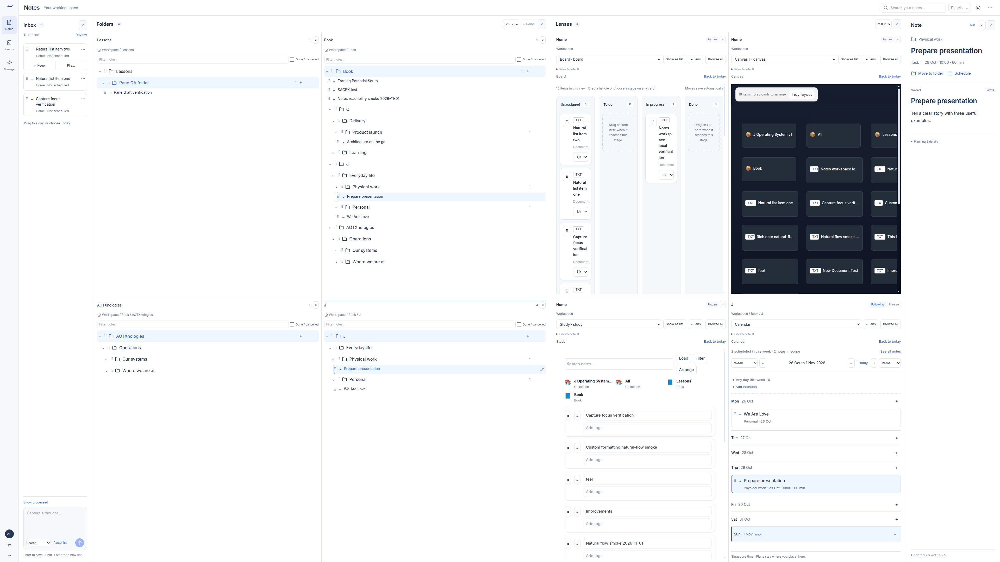

# Notes panes verification, 1 November 2026

## Delivered behavior

- Folders: add/remove between one and four independent panes over shared folders and notes. Independent focus, expanded branches, note filters and done/cancelled visibility; Workspace remains reachable.
- Lenses: one Following pane and up to three Frozen panes. Folder selection updates Following; Frozen retains context while data stays live. Closing the active folder pane switches Following to the remaining active folder.
- Each group independently supports 1 x 4 or 2 x 2, pointer/keyboard resizing, readable minima and contained overflow.
- Saved folder-owned lenses remain globally browsable, with List alternatives and a preferred lens per folder remembered on this browser.
- The active folder's + offers an inline new-folder row or a new-note draft row mirrored from the shared Note editor. Save finalizes, Discard removes the draft, failed saves retain it.
- Cross-pane note and folder moves use existing authorized, version-aware application paths. Self/descendant folder moves are rejected. Unsaved inline edits prevent closing their pane.
- Existing calendar layouts, note status, inline rename, one shared editor, app rail and Exams remain in place. No backend or schema changes.

## Automated checks

- Frontend production build: PASS. Existing lint warnings elsewhere remain.
- Focused Notes/Book lint: PASS, no warnings/errors.
- Pane state assertions: PASS, independent navigation, limits, frozen contexts, Following continuity, close slots and preference validation.
- Existing agenda runtime tests: 4/4 PASS.
- Exam access-code, unlimited-attempt and entry-field regressions: 5/5 PASS.
- Standalone frontend tsc: BLOCKED by pre-existing frontend/scripts/notes-agenda.test.ts line 6 fixture missing sprint.closed. No new type errors reported.
- git diff --check: PASS.

## Local browser checks

Existing disposable local QA database, frontend :4320 and API :4321. No production records changed.

- One-pane minimum and four-pane maximum in both groups; exactly one Following.
- Independent root/folder focus, Following selection and Frozen continuity.
- Both layouts at 3840 x 2160, pane count/layout/context restored after reload.
- Cross-pane note move and folder-with-note move, then restored their original local locations.
- Inline folder create/save/cancel and note preview/title synchronization, save and discard.
- Hidden/expanded pane draft retention; failed network save retained the note draft.
- Inline rename blocks pane close without dropping the edit.
- Per-pane note filtering and keyboard resizing.
- Saved Board, Canvas and Study rendered alongside Calendar in four lenses.
- Light/Charcoal checked. Mobile 390 x 844 and 4K document dimensions match viewport; overflow stays in the workspace.

The screenshot is the actual local 4K workspace with synthetic QA records. It is not production data or a design mockup. Temporary viewport override was reset. Local services and the review tab were left available.

## Limits

Layout, pane scopes and preferred lenses persist on this browser. They do not add cross-device database settings. A successful main push is separate from deployment completion. The existing standalone type-check failure is recorded above.
